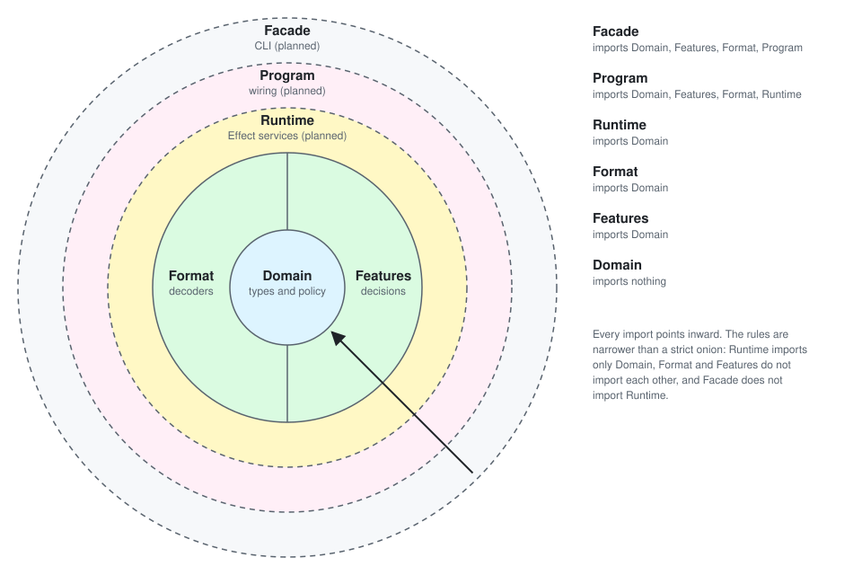

# tarlatan


Tarlatan is a small personal supervisor for coding agents. It drives unmodified Claude Code and Codex CLIs through tranches of work on one repository. Within a tranche, one agent implements, a fresh and independent process reviews, and the implementer corrects if the review asks for changes. Then the user approves before the next tranche starts. By default Claude implements and corrects and Codex reviews; the client for each role is configurable.

Tarlatan is meant to pace its launches against the user's subscription usage windows, start every step with fresh context, and keep durable checkpoints so a crash or restart does not lose its place.

The [API reference](https://ethan826.github.io/tarlatan/) documents every exported declaration in `src/` from its TSDoc. CI rebuilds it on each push to `main`. For the design in plain words, read [docs/how-it-works.md](docs/how-it-works.md).

## Status

The owner approved the design at revision 6.1 on 2026-11-15. Its open items stay open unless a later owner ruling resolves them. Tarlatan now runs the assisted cycle on one repository: the owner opens a session on a task file, Claude implements in a locked supervisor worktree, Codex reviews a snapshot of the result, Claude corrects at most twice, and the owner closes the session and commits. Every launch passes through the usage ledger and the hold rules, and Claude Code runs under a sandboxed editing profile with no permission-bypass flag. Since dogfood-1 (2026-11-22) tarlatan has run cycles on its own code; dogfood-4 renamed the project from foreman.

Launch admission is pacing. Tarlatan launches a step only when its own records leave room: the highest recent usage reading, plus a reservation for every step it has started and not yet retired, plus the new step's estimate, must stay under a cap below 100 percent. That bounds what tarlatan launches. It does not keep the provider's usage count under the cap or guarantee that the reserve is left for the user, because readings can be old and a running agent can use more than its estimate.

Live tests L1 and L2 (2026-11-16) showed that tarlatan can read both clients' usage, but those readings and the monotonic clock are not wired into admission yet, so every launch needs `--waive`. The L3 permission tests have run, and their C4 failure (a commit from inside the sandbox) was fixed and passed on rerun. L4 (crash and restart) waits on process control and recovery, which are designed but not written. Committing, moving branches and running the full test suite are still done by hand.

The record of each slice and cycle is in [the assisted-cycle plan](docs/plans/2026-11-19-assisted-cycle-plan.md). What remains before tarlatan is reliable in another repository is in [the robustness roadmap](docs/plans/2026-11-24-robustness-roadmap.md).

## Running it

Tarlatan reads a JSON configuration naming the project, its target checkout, the supervisor worktree, the state and ledger directories, the pinned client versions and the check commands. One cycle, run from a terminal:

```sh
bun src/facade/main.ts --config <file> worktree create   # once per target
bun src/facade/main.ts --config <file> session open --tranche <id> --task <path>
bun src/facade/main.ts --config <file> implement --waive
bun src/facade/main.ts --config <file> review --waive --attest
bun src/facade/main.ts --config <file> correct --findings <file> --waive --attest
bun src/facade/main.ts --config <file> session close --finished --attest
```

`status` reports the session, holds and grants as JSON. Every command and its exits are in [`src/facade/README.md`](src/facade/README.md).

## Design principles

- Decision-core architecture: a pure, total core of decisions with a thin shell around it. The CLI converts input and makes no decisions.
- TypeScript with Effect v4.
- Holds for quota, approval, uncertain operations and failures stay separate, and each is released only by its own event. Timers and notification timeouts never grant approval.
- No permission-bypass flags for either client.
- Agents may not edit protected instruction and git files unless the approval that started the tranche allows it.

## Architecture



Imports point inward. Domain imports nothing. Features and Format are the pure core and import only Domain. Dashed rings (Runtime, Program, Facade) hold no code. The drawing is generated by `docs/diagrams/onion.ts`; run `bun run diagram` after editing it.

## How it works

For sequence diagrams of a tranche and of a launch attempt, the hold states, a plain-words account of pacing, and what exists today, read [docs/how-it-works.md](docs/how-it-works.md). Each `src/` layer has a README linked from there. `bun run docs` builds the [API reference](https://ethan826.github.io/tarlatan/) from the TSDoc in `src/`.

## Why not Ralph

A disposable trial of Ralph 2.12.0 preceded this design. Its cooperative review routing worked, but the trial could not establish supported resume of a suspended primary loop or recovery of an interrupted operation. Its default calls also pass each client's permission-bypass flags, and it is far larger than a sequential workflow needs (254 Rust files). Ralph was studied and none of it was copied. Details are in `docs/plans/2026-11-14-ralph-trial-results.md`.

## Layout

- `src/domain`: identifiers, roles, outcomes, observations, usage windows, policy, holds, events and the session.
- `src/features`: pure decisions: pacing, admission, holds, the session's phases, snapshot and worktree checks.
- `src/format`: decoders and encoders for client output, git listings, configuration and briefs.
- `src/runtime`: the Effect shell: SQLite stores, git, processes and files.
- `src/program`: wiring of Runtime capabilities into the commands.
- `src/facade`: the CLI; `main.ts` is its entry point.
- `test`: tests for every layer.
- `docs/plans`: the decision record, the design, the plans, the task files of each cycle and the reviews.
- `research/live`: the live tests of the clients (L1 to L3) and their results.
- `lint-fixtures`: files each house lint rule must reject; `tools/prose`: the prose check.
- `research/model`: bounded model checks of the design. `check3.py` covers holds and recovery. `check4.py` covers the usage ledger and the scheduler. `check5.py` covers the grant rules of revision 5. `check51.py` checks revision 5.1's grant rules against its own count of the provider's use, and `check52.py` covers revision 5.2's grant settling and periods. The checks back only the properties the design's claims ledger cites. Each has a mutation test and saved output.

## Development

Install dependencies with `bun install`. Then:

```sh
bun run check   # tsc, ESLint and the prose check
bun run test    # vitest run
bun run diagram # rewrite docs/diagrams/onion.svg
bun run docs    # build the API reference into site/
```

`check`, `test` and a warning-free `docs` must pass before a commit.

## Design and reviews

Start with `docs/plans/2026-11-14-agent-supervisor-design.md`, then the admission contract and the implementation plan beside it. The decision record and the Ralph trial results are in the same directory, along with prose reviews.

## License

MIT. See [LICENSE](LICENSE).
