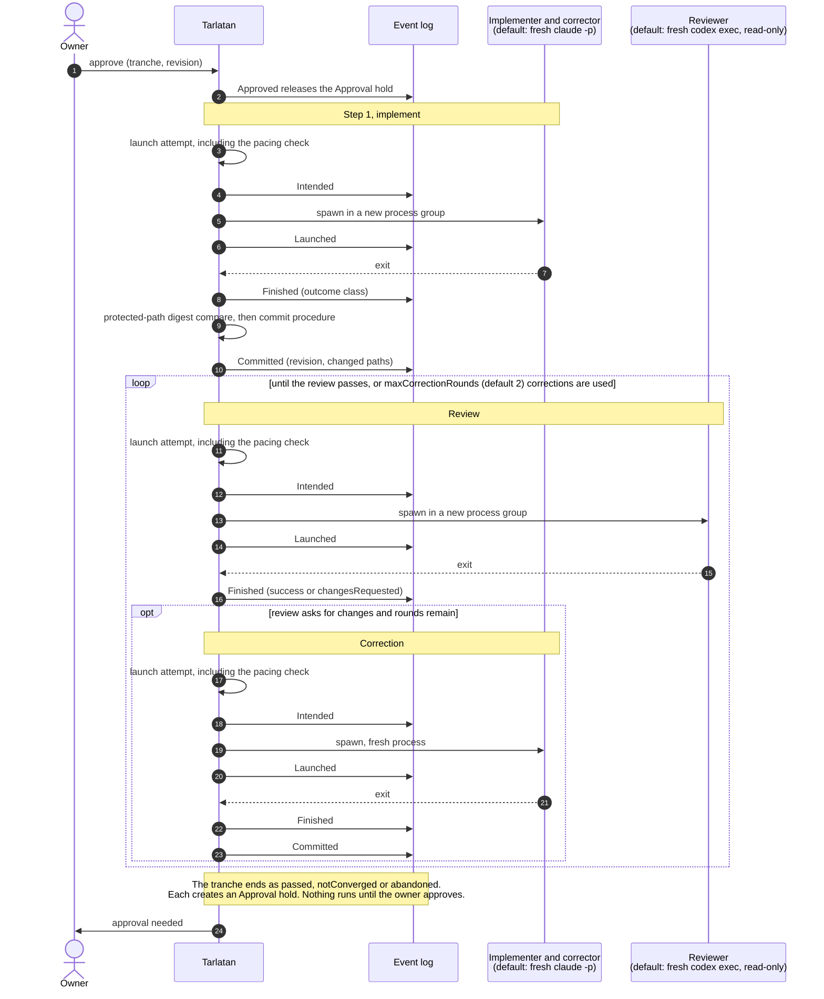
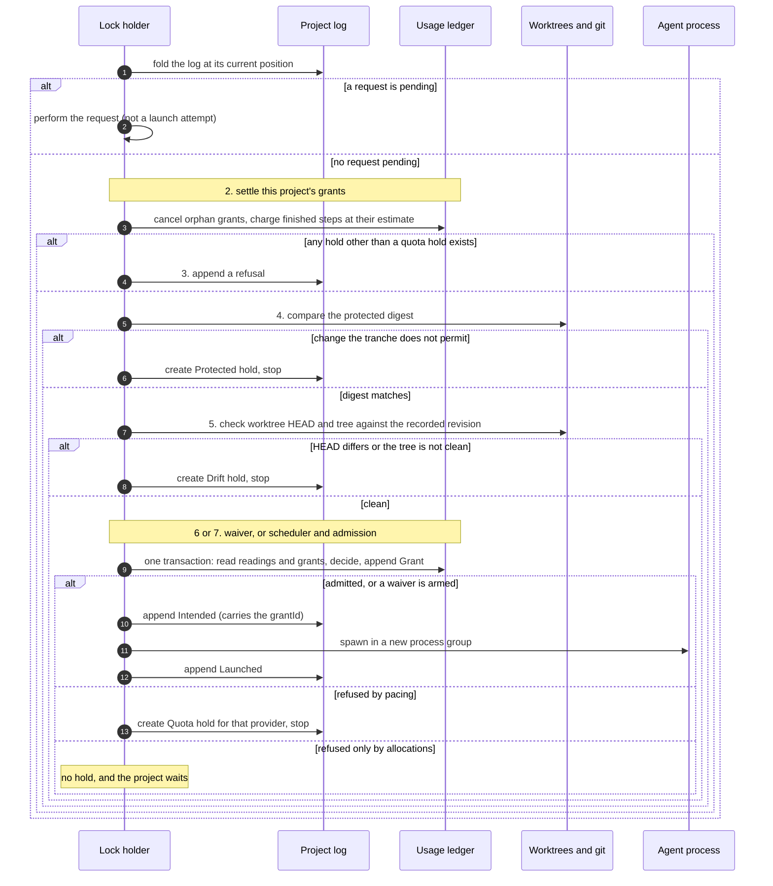
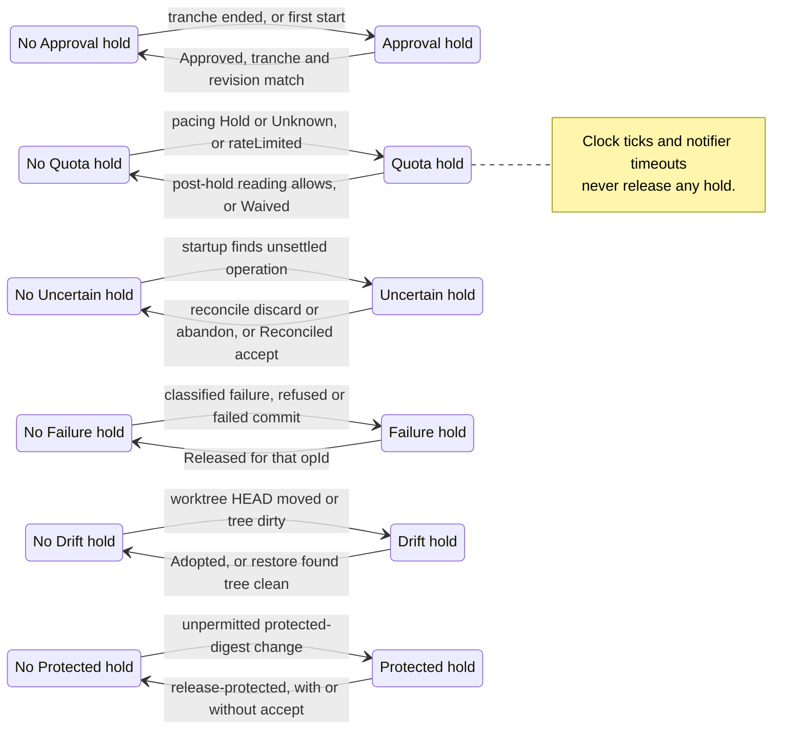
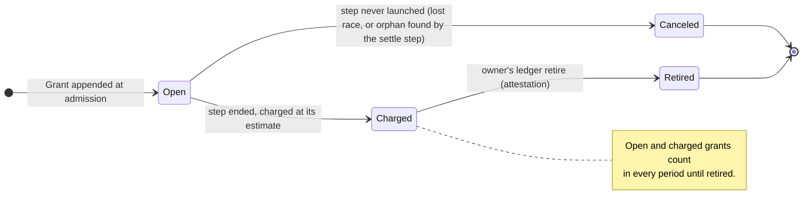

# How tarlatan works

Read the [README](../README.md) first. This page shows how the pieces fit, with diagrams, so you can follow the design before reading the code.

## Status

The owner approved [the design](plans/2026-11-14-agent-supervisor-design.md) at revision 6.1 on 2026-11-15. Its open items stay open unless a later owner ruling resolves them. The code runs the assisted cycle. The owner opens a session on a task file; Claude implements, Codex reviews, and Claude may correct twice. Every launch passes through the usage ledger and the hold rules, and the owner approves and commits. Admission does not yet read usage on its own, so every launch needs a waiver. Process control and recovery are designed but not written, and so is the commit procedure. [The robustness roadmap](plans/2026-11-24-robustness-roadmap.md) lists what remains; the rest of this page describes the approved design, which the code implements only in part.

## One tranche

A tranche is a unit of work the owner names in a task file. The diagram follows the default roles: Claude implements and corrects, Codex reviews. The owner can configure which client fills each role.

Points the diagram compresses:

- Every step is a fresh process. There is no `--resume` and no `--continue`. Its inputs are the task file, the previous step's handoff file and the working tree at the base revision.
- The commit procedure applies only to implement and correct steps. The reviewer does not commit.
- If the review still asks for changes after `maxCorrectionRounds` corrections, the tranche is recorded as `notConverged`. The design allows no extra rounds (ruling 1, 2026-11-14).
- Agents never work in the owner's checkout. Implement and correct steps run in a linked worktree that tarlatan owns, on its own branch. A newly created worktree gets the branch `tarlatan/<name>`; an existing worktree keeps the branch recorded when it was created, which may use the project's previous prefix. Reviews run in a second worktree detached at the revision under review. The owner's edits and commits in their own checkout never enter a step, and a tranche's work reaches the owner's branch only through a git command the owner runs.
- Every launch also takes a grant in the shared usage ledger before `Intended`, and the grant is charged after `Finished` (see "The usage ledger" below).
- The four records named in the diagram (Intended, Launched, Finished, Committed) are events in the project's append-only log in SQLite. State is a fold over that log. A crash or restart reads the log to find its place.
- With the default review-queue bound of 1, the next tranche starts only after the previous one has been reviewed. A bound of 2 lets one pre-approved tranche be implemented while the one below it waits for review; if that review asks for changes, the tranche above is unwound.

## One launch attempt

Before every step, the process that holds the project's lock runs the launch-attempt procedure. The numbers in the notes follow the design's list under "Launch attempt". A refusal or a created hold stops the attempt and consumes or expires the armed waiver, if any.

A launch attempt creates at most one hold, and only when it found none that blocks every launch (rule H1). A waived launch skips the admission check but still takes a grant at its estimate. If another writer appended to the project log between the fold and `Intended`, the instance cancels its grant at once and decides again.

The scheduler picks among at most three candidates: the correction of the head tranche (the only candidate when the last review asked for changes and rounds remain), its review, and the implement step of the next approved tranche when the review queue has room. Candidates are ordered by their provider's reset time, earliest first, and the first one that passes admission and is not under a quota hold for its provider launches.

## Holds

A launch is allowed only when no hold blocks it and no request is pending. A quota hold blocks only its own provider's steps; every other hold blocks every launch. Holds are keyed by reason and several can exist at once. Each is removed only by its own release event, and one release removes only its own hold. Clock ticks and notifier timeouts never release any hold.

The diagram shows each kind as its own pair of states, because several kinds can be present at once. The only arrows out of a hold are its own release events.

| Hold | Released only by |
|---|---|
| Approval (tranche, revision) | `Approved` from the CLI, with both fields matching the hold. It includes the protected-path permission for the next tranche. |
| Quota (provider, windows) | For every named window: a reading observed after the hold (by the monotonic clock, in the same boot) and ingested after it (by ledger `seq`) allows. Or `Waived(provider, waiverId)` from the CLI. A passed reset time releases nothing. |
| Uncertain (opId) | `reconcile <opId> discard`, `reconcile <opId> abandon`, or `Reconciled(opId, accept)` with that opId. |
| Failure (opId, class) | `Released(opId)` from the CLI. |
| Drift (worktree, expected, head, dirty) | For the supervisor worktree, `Adopted(revision)` or the completion of a `restore` that found the tree clean. For the review worktree, the completion of `restore --review`. |
| Protected (paths) | `release-protected`, which re-digests and releases if the files match the recorded digest again. With `--accept` it records the current digest as the new baseline and releases. |

A reading observed before the hold never releases it, even if it arrives later. An approval for one tranche and revision does not release a hold for another. A tranche that ends as `notConverged` creates only the approval hold.

[`src/domain/holds.ts`](../src/domain/holds.ts) is still empty; the Domain hold types are the first task of the implementation plan.

## The usage ledger

All tarlatan instances on the Mac share one SQLite database, the usage ledger, because they draw on the same subscription accounts. One tarlatan runs per target repository, and the ledger is the only state the projects share. Every ledger write is one `BEGIN IMMEDIATE` transaction, so admissions from different projects run one after the other, and each row gets a ledger-wide `seq` that orders it against every other row.

Admission reserves before it spends: the transaction that admits a step appends a grant for the step's estimate in every window. The grant then follows this life:

The settle step runs at every launch attempt and at startup, so a crash at any point leaves a grant open only until the project's next launch attempt or startup. Charges are always the estimate, because no client reports a step's use in the quota's own units. Whether a charged grant can stop counting without the owner is open (O7 and O8); the implementation plan sets out the choices and what each means for unattended use.

## How pacing works

Admission is pacing over tarlatan's own records. It bounds tarlatan's launches and reservations. It does not keep the provider's usage count under the cap, and it does not keep the reserve free for the owner's own use: a reading can be old when tarlatan sees it, and a running agent can use more than its estimate.

In plain words:

- Pacing checks once, at launch. Nothing stops a step once it is running.
- Pacing checks the windows listed in policy for the step's provider, whatever readings exist. For Claude these are the five-hour and weekly windows. The Codex windows are unknown until live test L2, so the default Codex policy lists none and every Codex launch needs a waiver.
- Readings belong to periods. Only a reading whose reset time is later than the current period's opens a new period. A drop in usage opens none, and a reading of an earlier period is never used.
- For each window, pacing uses the highest reading of the current period, stale readings included, so a late, lower reading never lowers the figure.
- A window is usable when its current period has a fresh reading and its reset time has not passed. Freshness is measured on the monotonic clock in the same boot: a reading observed in the last 10 minutes (the default) is fresh. Until the owner approves how tarlatan and the statusline script read that clock (open item O11), no reading is fresh and every launch needs a waiver.
- The level of a window is the highest reading plus every grant that still counts, from every project. A window allows a launch when the level plus the step's estimate is at most the cap, `100 − reserve` (30 percent reserve on the five-hour window and 40 percent on the weekly window by default), or the level a spend-down set for this period.
- The estimate per role and window is the largest measured increase among the role's last five finished steps, or 15 points when none was measured.
- The answer is one of three. Allow only if every policy window is usable and allows. Hold if a usable window fails. Otherwise Unknown. Unknown never turns into Allow by waiting, and no timer loosens anything. A Hold or an Unknown creates a Quota hold, and the owner can `waive` one launch.

Because charged grants keep counting until the owner retires them, the defaults allow at most 4 Claude launches on the five-hour window, about 2 per period, and at most 4 in a weekend on the weekly window. With readings only from the owner's interactive sessions, an unattended night probably gets about one Claude launch. Live test L1 decides whether tarlatan's own Claude output includes usable readings; the design's "Unattended launches" has the arithmetic.

## Where to read next

- [`src/domain`](../src/domain/README.md): the types, with class diagrams.
- [`src/format`](../src/format/README.md): the decoders.
- [`src/features`](../src/features/README.md): `pace` and the other decisions, with a flowchart.
- [`src/runtime`](../src/runtime/README.md), [`src/program`](../src/program/README.md), [`src/facade`](../src/facade/README.md): the layers for the Effect shell, the wiring and the CLI.
- [The design](plans/2026-11-14-agent-supervisor-design.md): Scope, Holds, Pacing, Usage ledger, Stages, Operations and recovery, Open items.
- [The implementation plan](plans/2026-11-15-implementation-plan.md): what is authorized, what needs approval, what waits on a decision or a live test.
- [Dependency intake](dependency-intake.md): why each package is there.
