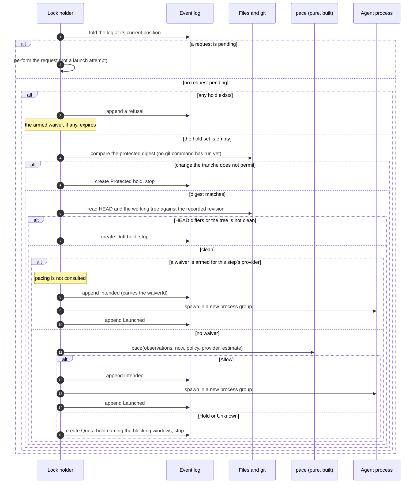
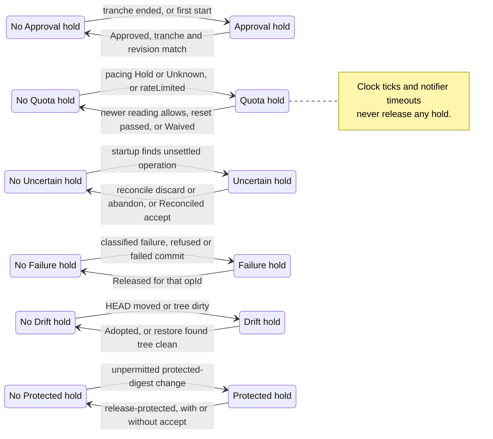

# How foreman works

Read the [README](../README.md) first. This page shows how the pieces fit, with diagrams, so you can follow the design before reading the code.

## What is built and what is planned

Almost all of the runtime behavior described below is **planned**. The design is a draft (revision 3, not approved), and nothing runs agents yet. What exists is a first code slice:

- **Built:** the Domain types, the Format decoders for Claude and Codex output, and the pure pacing function `pace` (provisional until the design is approved).
- **Planned:** the event log, process control, git handling, holds, recovery and the CLI.

Each diagram below is labeled **built** or **planned**. A planned diagram shows the design's text, not working code. The source is [the design](plans/2026-11-14-agent-supervisor-design.md), which is still under review and may change.

## One tranche (planned)

A tranche is a unit of work the owner names in a task file. The diagram follows the default roles: Claude implements and corrects, Codex reviews. The owner can configure which client fills each role.

Points the diagram compresses:

- Every step is a fresh process. There is no `--resume` and no `--continue`. Its inputs are the task file, the previous step's handoff file and the working tree at the base revision.
- The commit procedure applies only to implement and correct steps. The reviewer does not commit.
- If the review still asks for changes after `maxCorrectionRounds` corrections, the tranche is recorded as `notConverged`. The design allows no extra rounds (ruling 1, 2026-11-14).
- The design text still has the agents sharing the owner's working tree. The owner ruled on 2026-11-15 that every agent step runs in a supervisor-owned linked worktree on its own branch, so the owner's edits cannot be committed as an agent's step. The design text has not been updated to match.
- The four records named in the task (Intended, Launched, Finished, Committed) are events in an append-only log in SQLite. State is a fold over that log. A crash or restart reads the log to find its place.

## One launch attempt (planned, pacing call built)

Before every step, the process that holds the instance lock runs the launch-attempt procedure. The numbers follow the design's list. A refusal or a created hold stops the attempt and consumes or expires the armed waiver, if any. The pure `pace` function in the diagram is the **built** part: see [src/features](../src/features/README.md).

A launch attempt creates at most one hold, and only when it found none (rule H1).

## Holds (planned)

A launch is allowed only when the hold set is empty and no request is pending. Holds are keyed by reason and several can exist at once. Each is removed only by its own release event, and one release removes only its own hold. Clock ticks and notifier timeouts never release any hold.

The diagram shows each kind as its own pair of states, because several kinds can be present at once. The only arrows out of a hold are its own release events.

| Hold | Released only by |
|---|---|
| Approval (tranche, revision) | `Approved` from the CLI, with both fields matching the hold. It carries the protected-path permission for the next tranche. |
| Quota (provider, windows, heldAt) | For every named window: the newest reading has `observedAt > heldAt` and allows, or the reset time reported for that window has passed. Or `Waived(provider, waiverId)` from the CLI. |
| Uncertain (opId) | `reconcile <opId> discard`, `reconcile <opId> abandon`, or `Reconciled(opId, accept)`, naming that opId. |
| Failure (opId, class) | `Released(opId)` from the CLI. |
| Drift (expected, head, dirty) | `Adopted(revision)`, or the completion of a `restore` that found the tree clean. |
| Protected (paths) | `release-protected`, which re-digests and releases if the files match the recorded digest again. With `--accept` it records the current digest as the new baseline and releases. |

The Quota release rule has one more condition: a reading counts as post-hold only if it was also ingested after the hold was appended. An approval for one tranche and revision does not release a hold for another. A tranche that ends as `notConverged` creates only the approval hold.

The Domain hold types are not written yet. [`src/domain/holds.ts`](../src/domain/holds.ts) is an empty placeholder until the event grammar is approved.

## How pacing works

The `pace` function itself is **built** and provisional. The inputs it needs from the shell are **planned**. See [src/features](../src/features/README.md) for the flowchart.

In plain words:

- **Checked once, at launch.** Before a step starts, pacing compares the account's observed usage against a threshold. The reserve bounds launches, not usage. The design contains no rule that stops a step once it is running, and a running agent can overshoot, so there is no hard guarantee.
- **Observed usage windows.** For Claude the policy lists the five-hour and weekly windows. The windows checked are the ones in the policy, not whichever ones happen to have readings. The Codex windows are unknown until live test L2, so the default Codex policy lists none and every Codex launch needs a waiver.
- **The newest reading decides.** For each window the reading with the latest `observedAt` is used, even if it is unusable. An older reading never stands in. A reading is usable if it is no older than the freshness limit (default 10 minutes), is not stamped in the future, and has not passed its reset time.
- **Reserve held back.** A window allows a launch when used percent plus the step's estimated cost stays at or below 100 minus the reserve. The defaults, confirmed by the owner on 2026-11-14 and configurable, are a 30 percent reserve on the five-hour window and 40 percent on the weekly window.
- **Estimate from measured step costs (planned).** The design takes the role's last five finished steps, uses the largest measured increase in the window, and falls back to an initial estimate of 15 points when none was measured. Today `pace` takes the estimate as a parameter.
- **Three answers.** Allow only if every policy window has a usable reading that allows. Hold if any usable reading fails. Otherwise Unknown, for example when readings are missing or stale. Unknown never turns into Allow by waiting. A Hold or an Unknown creates a Quota hold, and the owner can `waive` one launch.

## Where to read next

- [`src/domain`](../src/domain/README.md): the built types, with class diagrams.
- [`src/format`](../src/format/README.md): the built decoders.
- [`src/features`](../src/features/README.md): `pace`, with a flowchart.
- [`src/runtime`](../src/runtime/README.md), [`src/program`](../src/program/README.md), [`src/facade`](../src/facade/README.md): planned layers, no code yet.
- [The design](plans/2026-11-14-agent-supervisor-design.md): Scope, Holds, Pacing, Operations and recovery, Context per step.
- [Dependency intake](dependency-intake.md): why each package is there.
