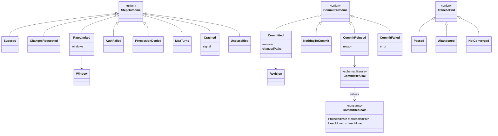
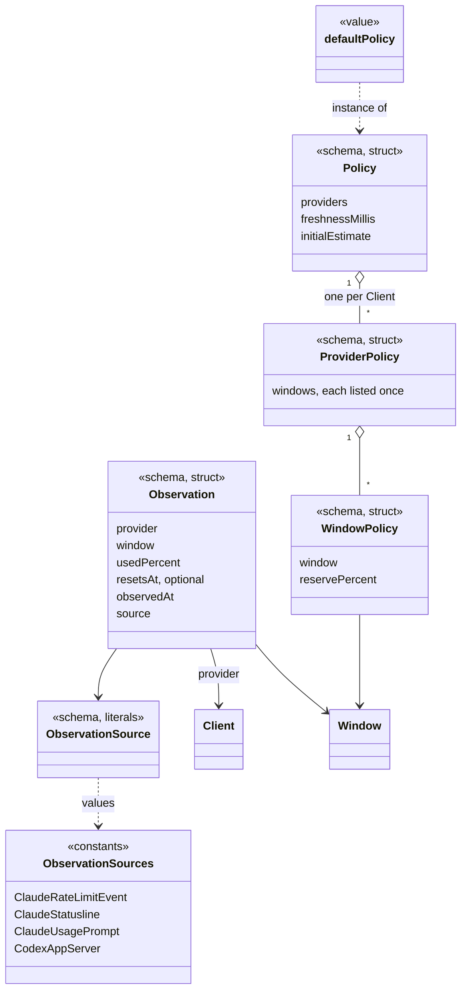

# Domain

Built. Plain data and validators. They cover what the other layers pass around: identifiers, clients, roles, steps, outcomes, usage observations, windows, pacing policy. Back to [how it works](../../docs/how-it-works.md).

May import: nothing.

Domain sits at the center of the layer table in `eslint.rules.js`, so every other layer can depend on it and it depends on none of them. Outside `effect`, it imports nothing, which keeps it free of process, file and clock code and easy to test.

Conventions: each closed vocabulary (clients, roles, windows, observation sources, commit refusals) is a named `as const` object, and its schema derives from that object. Schemas and their types share a name. Times are epoch milliseconds on the supervisor's local clock. [`holds.ts`](holds.ts) is an empty placeholder (planned): hold types wait for the approved design.

The diagrams show type names and the main relations. They do not show every field or its constraints; read the source for those.

## Identifiers, vocabularies and steps

## Outcomes

A step ends in a `StepOutcome`. A commit ends in a `CommitOutcome`. A tranche ends in a `TrancheEnd`. Each member is a tagged class, and each union is a schema.

## Observations and policy

An `Observation` is one usage reading. A `Policy` says which windows are checked for each provider and how much to hold back. `defaultPolicy` lists the Claude windows and none for Codex, pending live test L2.

Read next: [Format](../format/README.md) and [Features](../features/README.md), which import these types.
