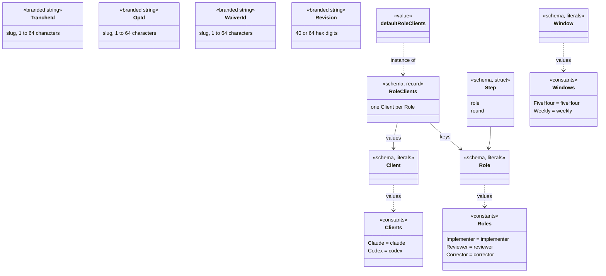
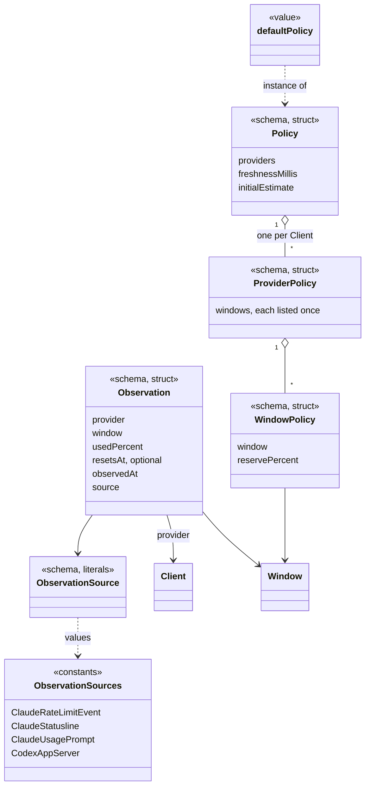
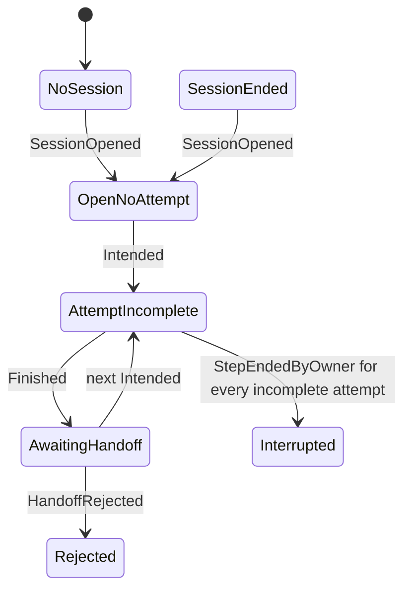

# Domain

Plain data and validators for what the other layers pass around. These include identifiers, clients, roles, steps and outcomes. Usage observations, windows and the pacing policy are here too, as are monotonic stamps, grants and holds. So are the project log's events, the assisted session and its states, snapshot checks, client processes, the two permission profiles and a reviewer's findings. Back to [how it works](../../docs/how-it-works.md).

May import: nothing.

Domain sits at the center of the layer table in `eslint.rules.js`, so every other layer can depend on it and it depends on none of them. Outside `effect`, it imports nothing, which keeps it free of process, file and clock code and easy to test.

Conventions: each closed vocabulary (clients, roles, windows, observation sources, commit refusals) is a named `as const` object, and its schema derives from that object. Schemas and their types share a name. Wall-clock times are epoch milliseconds, used for display and for `now >= resetsAt` only. Freshness and ordering use [`clock.ts`](clock.ts) (`MonoStamp`: monotonic microseconds with a boot id) and the ledger's `LedgerSeq`. [`holds.ts`](holds.ts) declares the six holds of the design's table, and [`grant.ts`](grant.ts) the points a counting grant adds to a window.

The diagrams show type names and the main relations. They do not show every field or its constraints; read the source for those.

## Identifiers, vocabularies and steps

## Outcomes

A step ends in a `StepOutcome`. A commit ends in a `CommitOutcome`. A tranche ends in a `TrancheEnd`. Each member is a tagged class, and each union is a schema.

## Observations and policy

An `Observation` is one usage reading. A `Policy` says which windows are checked for each provider and how much to hold back. `defaultPolicy` lists the Claude windows and none for Codex, pending live test L2.

## Project log events

[`events.ts`](events.ts) holds `ProjectEvent`, the union of every event a project's append-only log can hold, along with `LogPosition`, the log's errors and the `ProjectLog` capability. The members live in four modules, and `events.ts` re-exports all of them so importers see one module:

- [`step-events.ts`](step-events.ts): a step's `Intended`, `Launched`, `Finished` and `CommitRecorded`. `Launched` records the leader's process group and, in `leaderStartedAt`, the leader's start time as `ps` printed it right after spawn, or nothing when that read failed.
- [`owner-events.ts`](owner-events.ts): the owner's rulings. `Approved` and `PreApproved` let tranches start. `Waived` arms a waiver, and `WaiverExpired` ends an unused one. `Released`, `Adopted`, `Reconciled` and `ProtectedReleased` record the rest.
- [`worktree-events.ts`](worktree-events.ts): the review queue (`ReviewQueued`, `Unwound`) and `TrancheEnded`. `LedgerBound` binds the ledger. `WorktreeIntended`, `WorktreeCreated` and `Rebased` follow the supervisor worktree; the owner's requests end in `RequestCompleted`. `HoldCreated` includes the hold it creates.
- [`session-events.ts`](session-events.ts): the assisted session's events, described next.

## Assisted session

[`session.ts`](session.ts) holds the session's identifiers (`SessionId`, `HandoffId`), the `Sha256` digest, the supervisor worktree's `RecordedGitIdentity` (three absolute paths; decoding refuses a relative one), and the owner's commands, one tagged class each, in the union `SessionCommand`. Its two closed vocabularies are `CloseKinds`, the ways a session closes, and `Attestations`. The one attestation, `quiescence-and-inspection`, is what the owner's `--attest` asserts: no process of an earlier attempt still runs, and the protected inputs were inspected since that attempt.

[`session-events.ts`](session-events.ts) puts a session in the log. `SessionOpened` and `SessionClosed` bracket it. Each attempt's `ReportRecorded` lists the attempt's raw output file and handoff file with the SHA-256 of each, and is appended in one batch with the attempt's `Finished`. `SnapshotTaken`, `HandoffApproved`, `HandoffRejected` and `ReviewChecked` record the handoffs between attempts. `StepEndedByOwner` is the owner's attestation that an attempt with no `Finished` has ended; settlement then charges its grant, and no outcome is written for it.

[`session-state.ts`](session-state.ts) declares the states that Features folds from the log. Each open state holds the session's facts (`OpenSession`): how it was opened, its attempts in log order, its recorded reports, the number of corrections launched and the tree the latest review was given. The fold also returns the waiver armed for each provider (`ArmedWaivers`). The diagram shows the events that move the state on the usual path; `SessionClosed` moves any open state to `SessionEnded`, and the close rules in Features decide which close each state allows.

`AwaitingHandoff` holds the last attempt's role and outcome and whether the outcome is usable; an unusable one leaves only `close --abandoned`.

## Snapshots and client runs

[`snapshot.ts`](snapshot.ts) holds the snapshot's raw-check types. `ObservedEntry` is what Runtime found at one tree entry's path, read with `lstat` and never through a link at the path itself: a regular file with its executable bit and blob id, a symbolic link with the blob id of its link text, another kind, nothing, or an unreadable path. `SnapshotMismatch` is one entry the bytes on disk do not support, and `SnapshotVerdict` is either `SnapshotConsistent` or `SnapshotInconsistent` with every mismatch in tree order. `ReviewCurrency` says whether a review still applies: `ReviewCurrent` only when the fresh snapshot is the reviewed tree. Blob ids are `BlobHex`, SHA-1 only, and a repository in another object format fails with `SnapshotObjectFormatRefused`. The preflight's types come next (review finding B08). `WalkedChild` is one directory entry with its kind. `PreflightFinding` is a `GitlinkInBase`, a `NestedRepository`, a `SpecialFile` or a `WalkUnreadable`, and `SnapshotPreflightRefused` lists every finding when the preflight refuses before staging. `WalkStep` is the walk's next step for one entry: `WalkInto` a directory or `WalkFound` a finding, each with whether git must first say the path is not ignored. The observations assume the assisted rung's quiescence (review limit L02): the directories above a path are trusted to stay put.

[`process.ts`](process.ts) describes a client's process as foreman records and observes it. `ProcessLeader` is the leader's pid, its process group and its start time, which `Launched` records. A start time is kept as the text `ps -o lstart` prints, so an equal pid with equal text identifies a process to the second. `ProcessEvidence` is what a later listing shows about that leader and its group. It is advisory only. Foreman never signals, and an empty listing is not evidence of cleanup. The module also holds the typed failures of starting a client and of reading the listing.

[`profiles.ts`](profiles.ts) builds the two fixed permission profiles as argv. `claudeEditingArgv` is Claude's `-p` with stream-json output, `--permission-mode dontAsk` and the owner's settings file, for the implementer and the corrector. `codexReviewArgv` is `codex exec` with a read-only sandbox, `approval_policy="never"`, `--json` and `--output-last-message`, for the reviewer. Neither has a bypass flag or resumes a session. Only the L3 subset run can confirm the exact flags, and it has not run.

[`findings.ts`](findings.ts) holds a reviewer's `Findings`: each has an id, a severity in the reviewer's own words, an optional file and a summary. An empty list asks for no changes. `NoFindingsBlock` and `MalformedFindings` are the decoder's failures; a review run that ends cleanly with either is `Unclassified`.

[`attributes.ts`](attributes.ts) holds the attribute check's readings and refusals, and `AttributeAllowance`: exact lines a target may keep in its root `.gitattributes` (owner decision M09, option a). `noAttributeAllowance` permits no line.

Read next: [Format](../format/README.md) and [Features](../features/README.md), which import these types.
