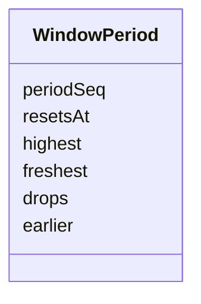
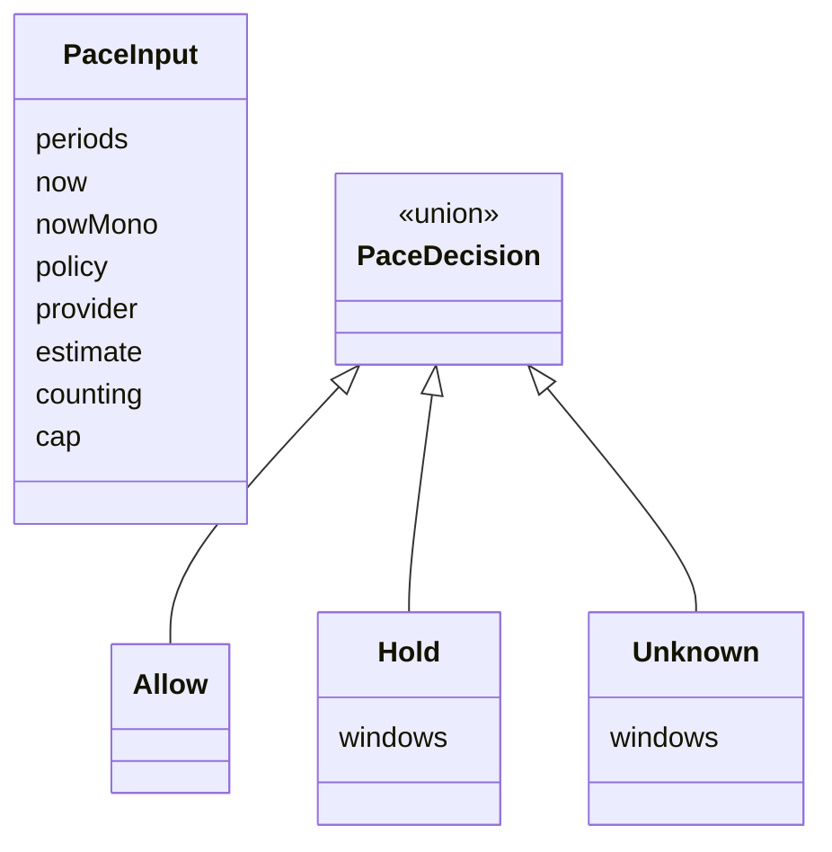
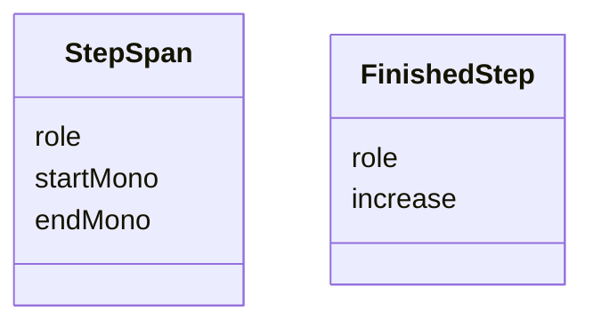

# Features

Pure decision functions: period membership (`periods.ts`), pacing (`pace.ts`) and the estimate per role and window (`estimate.ts`). They follow design revision 6.1. Later sections cover Part B's decisions and the assisted session's rules. Back to [how it works](../../docs/how-it-works.md).

May import: `domain`.

Features is a pure core layer. It may import Domain and nothing else of ours, Format included, so a decision never depends on how input was decoded or where it came from. A module that needs decoded input declares the fields it reads. The lint table also bars Node and Bun imports. Nothing here reads a clock or a file; the caller passes the wall-clock `now`, the monotonic `nowMono`, the readings and the grants.

Admission is pacing over foreman's own records. It bounds foreman's launches and reservations given those records. It does not bound the provider's count, a step's real use or the reserve.

## Periods

`currentPeriod(readings, policy)` folds one provider window's readings in ledger `seq` order into a `WindowPeriod`. Only a reading whose reset time is later than the period's by more than `resetTolerance` opens the next period. A usage drop opens nothing, and a reading of an earlier period is set aside. The period keeps the highest reading and the freshest monotonic stamp.

## pace

`pace(input)` returns one of three decisions, each a tagged class. `level(period, counting, window)` is the period's highest reading plus the points of every counting grant for the window. `defaultCap` is `100 - reserve`.

`Hold` and `Unknown` each hold the policy windows that lack a usable reading that allows, in policy order.

Details the flowchart leaves out:

- With no monotonic clock (`nowMono` none) no window is usable. Until the owner decides how foreman reads that clock (O11), every launch is Unknown and needs a waiver.
- A stale reading still raises the period's highest reading.
- A provider whose policy lists no windows is Unknown, never Allow. The default Codex policy lists none until the owner decides how Codex's reset times open periods (O14).
- `pace` builds each window's period from the asked provider's readings only; window names are shared across providers.
- The estimate used at admission is never below `minEstimatePoints` (1 point, owner ruling O15).
- Which grants count is the caller's decision. `pace` keeps only the asked provider's grants and sums each window's points.
- The wall clock enters only through `now < resetsAt`, which tightens as time passes.

## estimate

`estimate(finished, role, policy)` gives, per window, the largest measured increase among the role's last five finished steps. When none of them is measured in that window it gives `initialEstimate`. `measuredIncrease(step, readings, window, policy)` brackets one step: the latest reading at or before its monotonic start and the earliest at or after its monotonic end, both in the step's boot and both with the same reset time. The reading before must be at most `freshness` older than the start and the reading after at most `freshness` newer than the end. Both bracketing readings must be fresh relative to their own step boundary (owner ruling 2026-11-16), so fewer steps are measured. A measured increase is an observation of the provider's count across the step. It is not authoritative per-step usage: readings are whole points, arrive late, and include other use of the account.

## Grants, holds and scheduling

Part B's first milestone adds these pure modules. Each folds the project log or reads a ledger snapshot, and none reads a clock:

- [`counting.ts`](counting.ts): which grants count, with the retirement rule injected (`ownerOnly` is choice 1).
- [`settle.ts`](settle.ts): the settle step, which cancels orphan grants and charges finished steps at their estimate, and `ownerSettle` for `ledger settle`. A step that has no `Finished` but has the owner's `StepEndedByOwner` for that step and grant is charged at its estimate too, at the attestation's time, whether it launched or not (`ChargeFromOwnerEnded`). Such a step is no longer in flight.
- [`binding.ts`](binding.ts): the ledger binding check at startup.
- [`holds.ts`](holds.ts): the holds left by the log and their release rules, and `quotaReleased` for readings.
- [`waiver.ts`](waiver.ts) and [`spend-down.ts`](spend-down.ts): armed waivers, the active spend-down and the cap it sets. `unusedWaivers` names the armed waivers an attempt expires: every one its `Intended` does not name, so all of them for a refused attempt.
- [`review-queue.ts`](review-queue.ts): the review queue, its bound and unwinding.
- [`backlog.ts`](backlog.ts): pre-approvals and the approval each tranche starts under.
- [`schedule.ts`](schedule.ts): the next step, ordered by provider reset time (an invented heuristic, flagged in the design).

## Worktree startup check

[`worktree-check.ts`](worktree-check.ts) holds `checkWorktree`, which decides whether the recorded path is listed on `refs/heads/<branch>` and locked, and whether a directory is present there with the recorded git directory and common directory. A listed registration alone does not show that the worktree exists. It returns the entry, or `WorktreeCheckFailed` with each condition that failed. It judges the raw reading: nothing or a file at the path means no directory is present, and an identity command that reported no repository there does not identify the worktree. An identity command that git could not complete never reaches this judgment. A path that is not listed is reported alone, a missing directory is not also reported as the wrong identity, and a detached entry is not on the branch. Paths compare exactly. A recorded worktree with an empty field returns `WorktreeRecordInvalid` instead of throwing.

[`worktree-created.ts`](worktree-created.ts) holds `checkCreated`, run after `git worktree add`: the new worktree's top level must be the requested path with symlinks resolved, and HEAD must be `refs/heads/foreman/<name>`. Otherwise it returns `WorktreeNotAsCreated` with both sides.

[`attribute-sources.ts`](attribute-sources.ts) holds `checkAttributeSources(reading, allowance)` (plan B11c, option A). It never interprets a declaration, and the only path it compares is the root `.gitattributes`. Four conditions must hold for a revision and repository to pass. Every `.gitattributes` entry is a regular blob of blank and comment lines. `<commonDir>/info/attributes` is absent or an empty regular file. `git config --get core.attributesFile` exited 1. `git config --get-regexp '^includeif\.'` exited 1, so the config holds no conditional include (option R). A blank line holds only spaces and tabs and at most a final CR; a comment line starts with `#` at its first character. Anything else, a symbolic link or other kind of entry, and every failed read is a refusal. The one exception is the allowance (owner decision M09, option a): a line of the root `.gitattributes` also passes when it equals one of `allowance.rootLines` byte for byte once its `\n` and one CR before it are removed. A last line with no `\n` keeps its CR. The allowance never applies to a nested `.gitattributes`, to `info/attributes`, to the setting or to a conditional include, and `noAttributeAllowance` leaves option A unchanged. `AttributeSourcesRefused` lists each refusal with its source, its path and its line number where there is one. `isAttributesEntry` and `isRegularBlob` tell Program which entries to read.

[`worktree-precheck.ts`](worktree-precheck.ts) holds the creation prechecks over raw results. `requireAbsolute` refuses a path that does not start with `/`, before any git command. `refuseExistingBranch` reads the branch probe's exit code: 0 means the branch exists, 1 means it does not, and anything else is a failed command. `refuseExistingPath` refuses anything `stat` found at the path. The path is refused only if it exists when this check runs. An empty directory that appears before `git worktree add` may still be accepted by git, and no lock prevents that.

## Assisted session

These modules decide the assisted session's commands (plan "Assisted cycle", slices A1 and A2). They read the project log and the facts Program observes; none reads a clock, a file or a process.

[`session.ts`](session.ts) holds `foldSession`, which folds the log into the current session's state (Domain's `session-state.ts`) and the waiver armed for each provider. One session is open at a time, events that name another session are ignored, and only a log event changes the state. Within an open session an incomplete attempt outranks a rejection, and a rejection outranks the last finished attempt. With no incomplete attempt and no rejection, the state is `AwaitingHandoff` after the last attempt, or `OpenNoAttempt` before the first. [`session-attempts.ts`](session-attempts.ts) records each attempt's first `BriefRecorded` for the open session, its first `Launched`, first `Finished` and the owner's first attestation for its grant, so a later duplicate changes nothing. [`session-phases.ts`](session-phases.ts) answers the questions the command rules ask of a state, such as whether a usable review awaits its close.

[`command-rules.ts`](command-rules.ts) holds `allowed(command, state, checks)`, the plan's prerequisite matrix. It returns `Allowed`, or `Refused` with every reason that applies (the tagged reasons of [`command-refusals.ts`](command-refusals.ts)), so the owner sees all of them at once. Program observes the facts in `CommandChecks`: whether the lock is held, the worktree check, the launched client's version pin, the holds in place and the snapshot taken for the command. Each command checks only its own prerequisites:

- `status` always runs, and every other command needs the lock.
- `session open` is refused while a session is open, when the worktree check fails, or while any hold other than a quota hold is in place.
- A launch (`implement`, `review`, `correct`) needs the right state, a passing worktree check, a matching pin and no hold blocking its provider other than a quota hold.
- `review` and `correct` also need intact reports, the owner's `--attest` and a snapshot that passed the raw checks. For `correct`, the snapshot must be the reviewed tree, and a session allows at most two corrections (`maxCorrections`).
- `reject` needs a usable attempt awaiting its handoff, and `step-ended` an incomplete attempt of the open session with that attempt's grant, attested once.
- `session close --abandoned` needs an open session with no incomplete attempt, and `--interrupted` the `Interrupted` state. `--finished` needs a review with no changes requested, the attestation and a snapshot equal to the reviewed tree.

So `status`, `step-ended` and `close` stay reachable when the worktree, a client or a file is broken. A quota hold of the launched provider does not refuse a launch; `Allowed` then has `waiverStep` set, and the launch goes to the waiver step.

[`launch-facts.ts`](launch-facts.ts) supplies three of those facts. `pinMatches` is true only when the version command exited 0 and its trimmed output equals the pin exactly. `holdsInPlace` drops each quota hold that readings release. `quotaHoldFor` builds the quota hold that pacing's refusal records.

[`step-outcome.ts`](step-outcome.ts) classifies an attempt from the leader's exit and the decoded client events, never from the client's prose. A leader ended by a signal is `Crashed`. Otherwise a stream line that Format found malformed (a line that is not JSON or not an event object, or an outcome-bearing event that did not decode) makes the attempt `Unclassified`. Claude's `error_max_turns` result is `MaxTurns`. A clean run (exit 0, and Claude's `success` result with `is_error` false, or a completed Codex turn with no failure event, as Format reports them) is `Success`, except for a reviewer, whose findings block decides: an empty list is `Success`, a non-empty one `ChangesRequested`, and a missing or malformed block `Unclassified`. Everything else is `Unclassified`. Nothing yet shows how either client reports a rate limit, a failed login or a denied permission, so `RateLimited`, `AuthFailed` and `PermissionDenied` are never produced here. `usable(role, outcome)` says whether the session may go on: `Success` for the implementer or corrector, and `Success` or `ChangesRequested` for the reviewer.

[`snapshot.ts`](snapshot.ts) holds `judgeSnapshot`, the raw checks over a staged tree's entries and what Runtime found at each path. Modes 100644 and 100755 need a regular file whose executable bit matches and whose bytes have the entry's blob id; mode 120000 needs a symbolic link whose link text has it. Any other mode, a gitlink included, is refused whatever is on disk. It lists every mismatch in tree order, so a conversion git applied while staging, such as `core.autocrlf`, or a change after staging is refused instead of reviewed. `reviewCurrent` treats a review as current only when the fresh snapshot is the reviewed tree.

[`snapshot-preflight.ts`](snapshot-preflight.ts) holds the preflight's decisions, made before anything is staged (review finding B08, M14). `baseGitlinks` lists every gitlink of the base tree. `coverageOf` builds the coverage from the base tree and git's ignored listing: every base path and each directory above it is kept, whatever the ignore rules say. `walkSteps` decides, for one listed directory, what the walk does next. Below the top level, a `.git` entry of any kind makes the directory a `NestedRepository`, and the walk goes no further. Otherwise each subdirectory is walked, each special file becomes a `SpecialFile` finding, and regular files and links need nothing. A step asks `git check-ignore` first unless its path is kept. A subdirectory that git did not list as ignored is walked without asking, since git's listing only says where to ask.

[`process-evidence.ts`](process-evidence.ts) holds `processEvidence`, which reads a decoded `ps` listing against the leader `Launched` recorded. The leader counts as listed only with its recorded start time, since the system reuses process ids; members are the processes in the recorded group. The result is advisory and proves nothing.

[`client-environment.ts`](client-environment.ts) holds `clientEnvironment`: the parent's environment minus every variable whose name starts with `GIT_` (decision P2), so foreman's own git settings cannot redirect a client's git commands.

## Production boundaries

[`git-home.ts`](git-home.ts) holds `judgeGitHome` (batch review B02). Git's `HOME` passes only when it is a directory and not a symbolic link, foreman's user owns it, its mode is exactly 0700 and it is empty. Anything else is refused with every reason. An absent path is refused too, because Program judges only after creating it.

[`layout.ts`](layout.ts) holds `checkLayout` (batch review B05). The state directory and the supervisor worktree must lie outside the owner's checkout. The owner's checkout, the state directory and the ledger directory must lie outside the supervisor worktree, which is the one place a client may write. `isWithin` compares whole path components, so `/a/bc` is not inside `/a/b`. The state directory may hold the supervisor worktree, as the design lays it out.

[`target-binding.ts`](target-binding.ts) holds `compareTarget` (batch review B04). It compares every bound field of the configured target with the recorded binding and lists each difference, recorded value first.
