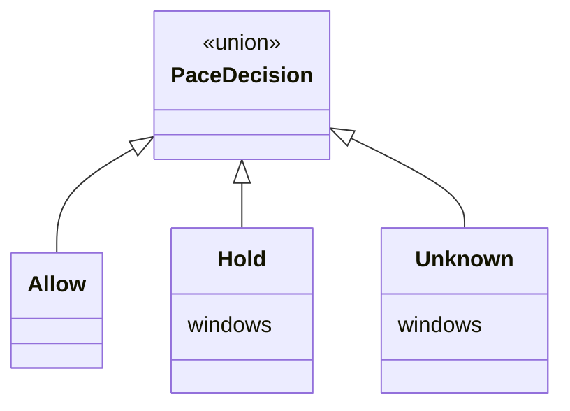
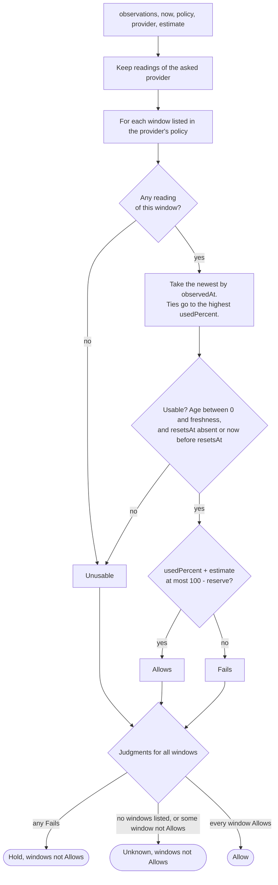

# Features

Pure decision functions. Only pacing exists, and it is provisional until the design is approved. Back to [how it works](../../docs/how-it-works.md).

May import: `domain`.

Features is a pure core layer. It may import Domain and nothing else of ours, Format included, so a decision never depends on how input was decoded or where it came from. The lint table also bars Node and Bun imports. `pace` therefore has no access to the clock or the file system; the caller passes `now`, the observations and the estimate.

## pace

`pace(observations, now, policy, provider, estimate)` returns one of three decisions, each a tagged class.

`Hold` and `Unknown` each hold the policy windows that lack a usable reading that allows, in policy order. The flowchart shows how the decision is reached.

Details the flowchart leaves out:

- The newest reading decides even when it is unusable. An older reading is never used in its place.
- A reading stamped after `now` is unusable (owner ruling, 2026-11-14).
- A provider whose policy lists no windows is Unknown, never Allow. The default Codex policy lists none until live test L2.
- `Allows`, `Fails` and `Unusable` are internal judgments and are not exported.
- `estimate` is a parameter. How it is computed from finished steps belongs to the shell.
