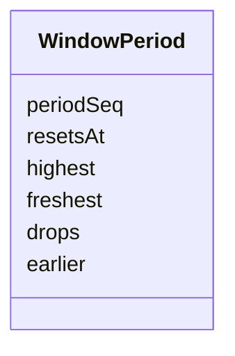
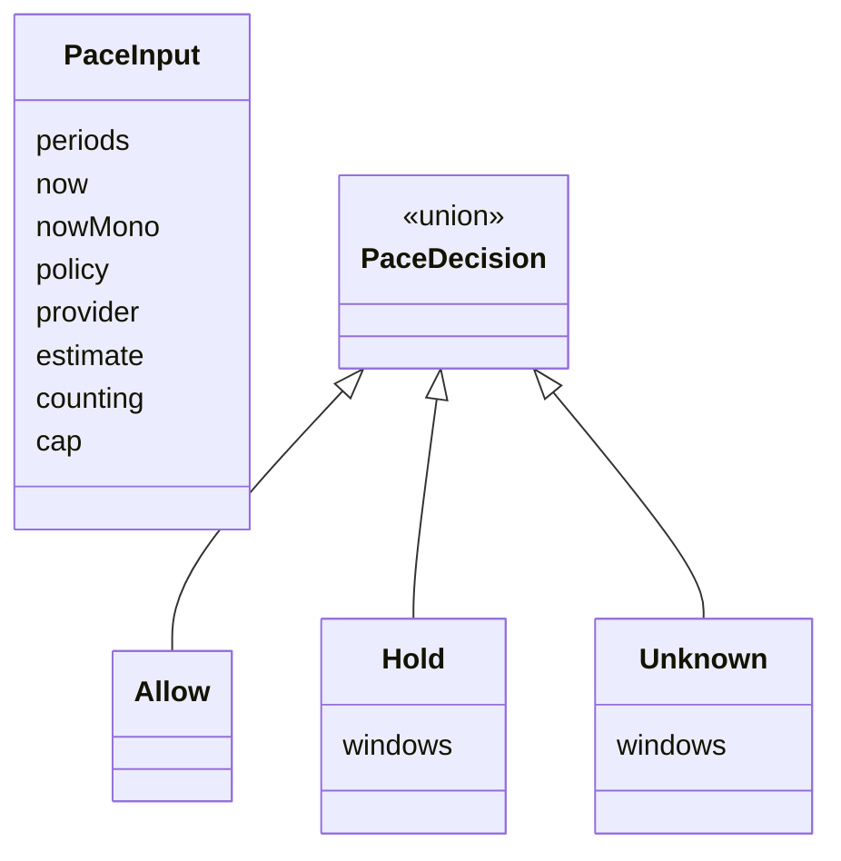
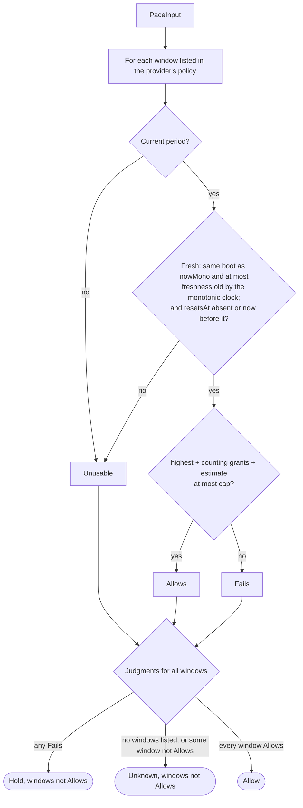

# Features

Pure decision functions: period membership (`periods.ts`) and pacing (`pace.ts`). They follow design revision 6.1. Back to [how it works](../../docs/how-it-works.md).

May import: `domain`.

Features is a pure core layer. It may import Domain and nothing else of ours, Format included, so a decision never depends on how input was decoded or where it came from. The lint table also bars Node and Bun imports. Nothing here reads a clock or a file; the caller passes the wall-clock `now`, the monotonic `nowMono`, the readings and the grants.

Admission is pacing over foreman's own records. It bounds foreman's launches and reservations given those records. It does not bound the provider's count, a step's real use or the reserve.

## Periods

`currentPeriod(readings, policy)` folds one provider window's readings in ledger `seq` order into a `WindowPeriod`. Only a reading whose reset time is later than the period's by more than `resetTolerance` opens the next period. A usage drop opens nothing, and a reading of an earlier period is set aside. The period keeps the highest reading and the freshest monotonic stamp.

## pace

`pace(input)` returns one of three decisions, each a tagged class. `level(period, counting, window)` is the period's highest reading plus the points of every counting grant for the window. `defaultCap` is `100 - reserve`.

`Hold` and `Unknown` each hold the policy windows that lack a usable reading that allows, in policy order.

Details the flowchart leaves out:

- With no monotonic clock (`nowMono` none) no window is usable. Until the owner decides how foreman reads that clock (O11), every launch is Unknown and needs a waiver.
- A stale reading still raises the period's highest reading.
- A provider whose policy lists no windows is Unknown, never Allow. The default Codex policy lists none until the owner decides how Codex's reset times open periods (O14).
- Which grants count is the caller's decision. `pace` keeps only the asked provider's grants and sums each window's points.
- The wall clock enters only through `now < resetsAt`, which tightens as time passes.
