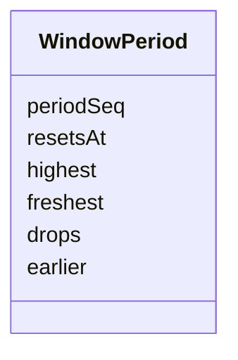
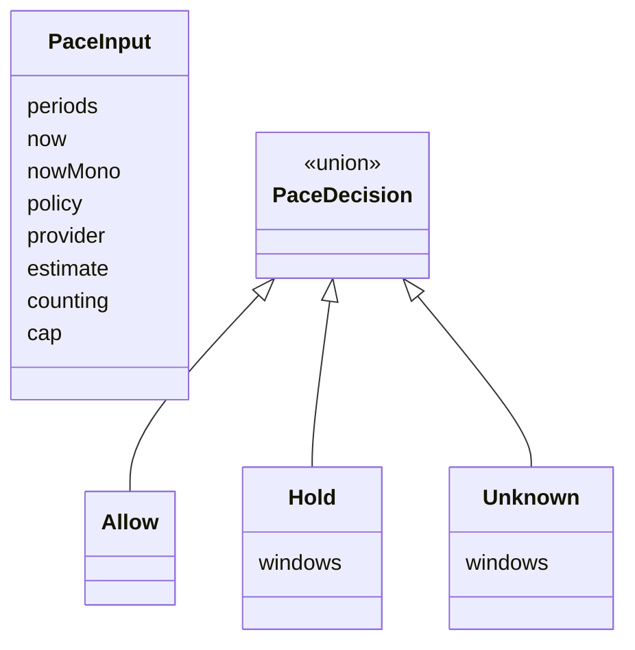
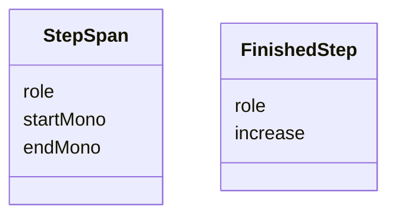

# Features

Pure decision functions: period membership (`periods.ts`), pacing (`pace.ts`) and the estimate per role and window (`estimate.ts`). They follow design revision 6.1. Back to [how it works](../../docs/how-it-works.md).

May import: `domain`.

Features is a pure core layer. It may import Domain and nothing else of ours, Format included, so a decision never depends on how input was decoded or where it came from. The lint table also bars Node and Bun imports. Nothing here reads a clock or a file; the caller passes the wall-clock `now`, the monotonic `nowMono`, the readings and the grants.

Admission is pacing over foreman's own records. It bounds foreman's launches and reservations given those records. It does not bound the provider's count, a step's real use or the reserve.

## Periods

`currentPeriod(readings, policy)` folds one provider window's readings in ledger `seq` order into a `WindowPeriod`. Only a reading whose reset time is later than the period's by more than `resetTolerance` opens the next period. A usage drop opens nothing, and a reading of an earlier period is set aside. The period keeps the highest reading and the freshest monotonic stamp.

## pace

`pace(input)` returns one of three decisions, each a tagged class. `level(period, counting, window)` is the period's highest reading plus the points of every counting grant for the window. `defaultCap` is `100 - reserve`.

`Hold` and `Unknown` each hold the policy windows that lack a usable reading that allows, in policy order.

Details the flowchart leaves out:

- With no monotonic clock (`nowMono` none) no window is usable. Until the owner decides how foreman reads that clock (O11), every launch is Unknown and needs a waiver.
- A stale reading still raises the period's highest reading.
- A provider whose policy lists no windows is Unknown, never Allow. The default Codex policy lists none until the owner decides how Codex's reset times open periods (O14).
- `pace` builds each window's period from the asked provider's readings only; window names are shared across providers.
- The estimate used at admission is never below `minEstimatePoints` (1 point, owner ruling O15).
- Which grants count is the caller's decision. `pace` keeps only the asked provider's grants and sums each window's points.
- The wall clock enters only through `now < resetsAt`, which tightens as time passes.

## estimate

`estimate(finished, role, policy)` gives, per window, the largest measured increase among the role's last five finished steps. When none of them is measured in that window it gives `initialEstimate`. `measuredIncrease(step, readings, window, policy)` brackets one step: the latest reading at or before its monotonic start and the earliest at or after its monotonic end, both in the step's boot and both with the same reset time. The reading before must be at most `freshness` older than the start and the reading after at most `freshness` newer than the end. Both bracketing readings must be fresh relative to their own step boundary (owner ruling 2026-11-16), so fewer steps are measured. A measured increase is an observation of the provider's count across the step. It is not authoritative per-step usage: readings are whole points, arrive late, and include other use of the account.

## Grants, holds and scheduling

Part B's first milestone adds these pure modules. Each folds the project log or reads a ledger snapshot, and none reads a clock:

- [`counting.ts`](counting.ts): which grants count, with the retirement rule injected (`ownerOnly` is choice 1).
- [`settle.ts`](settle.ts): the settle step, which cancels orphan grants and charges finished steps at their estimate, and `ownerSettle` for `ledger settle`.
- [`binding.ts`](binding.ts): the ledger binding check at startup.
- [`holds.ts`](holds.ts): the holds left by the log and their release rules, and `quotaReleased` for readings.
- [`waiver.ts`](waiver.ts) and [`spend-down.ts`](spend-down.ts): armed waivers, the active spend-down and the cap it sets.
- [`review-queue.ts`](review-queue.ts): the review queue, its bound and unwinding.
- [`backlog.ts`](backlog.ts): pre-approvals and the approval each tranche starts under.
- [`schedule.ts`](schedule.ts): the next step, ordered by provider reset time (an invented heuristic, flagged in the design).

## Worktree startup check

[`worktree-check.ts`](worktree-check.ts) holds `checkWorktree`, which decides whether the recorded path is listed on `refs/heads/<branch>` and locked, and whether a directory is present there with the recorded git directory and common directory. A listed registration alone does not show that the worktree exists. It returns the entry, or `WorktreeCheckFailed` with each condition that failed. A path that is not listed is reported alone, a missing directory is not also reported as the wrong identity, and a detached entry is not on the branch. Paths compare exactly. A recorded worktree with an empty field returns `WorktreeRecordInvalid` instead of throwing.

[`worktree-created.ts`](worktree-created.ts) holds `checkCreated`, run after `git worktree add`: the new worktree's top level must be the requested path with symlinks resolved, and HEAD must be `refs/heads/foreman/<name>`. Otherwise it returns `WorktreeNotAsCreated` with both sides.

[`worktree-precheck.ts`](worktree-precheck.ts) holds the creation prechecks over raw results. `requireAbsolute` refuses a path that does not start with `/`, before any git command. `refuseExistingBranch` reads the branch probe's exit code: 0 means the branch exists, 1 means it does not, and anything else is a failed command. `refuseExistingPath` refuses anything `stat` found at the path. The path is refused only if it exists when this check runs. An empty directory that appears before `git worktree add` may still be accepted by git, and no lock prevents that.
