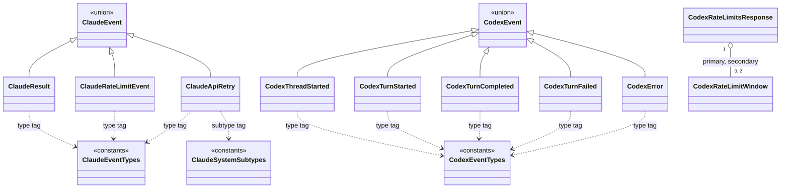

# Format

Built. Decoders for the output of the two agent clients: Claude's `--output-format json` result and stream-json events, and Codex's `codex exec --json` events and app-server rate-limit response. Back to [how it works](../../docs/how-it-works.md).

May import: `domain`.

Format is a pure core layer. It may import Domain and nothing else of ours, and not Features: that is stricter than the shared skill reference, as `AGENTS.md` records. The lint table also bars Node and Bun imports here, so a decoder takes parsed data and returns a `Result`. Reading a process stream belongs to Runtime (planned).

Almost every field is optional because the evidence in the design does not name it. Live tests L1 (Claude) and L2 (Codex) will settle the real shapes. Unknown extra fields are ignored, and an event type that is not listed fails to decode; the shell decides what an undecodable line means. Wire tags live in `ClaudeEventTypes`, `ClaudeSystemSubtypes` and `CodexEventTypes`.

The diagram shows the event and response types. The decoder functions are `decodeClaudeResult`, `decodeClaudeRateLimitEvent`, `decodeClaudeApiRetry`, `decodeClaudeEvent`, `decodeCodexEvent` and `decodeCodexRateLimitsResponse`. It does not show field names or optionality.

The decoded values are not yet turned into Domain `Observation` values. That mapping is planned and waits for L1 and L2.
